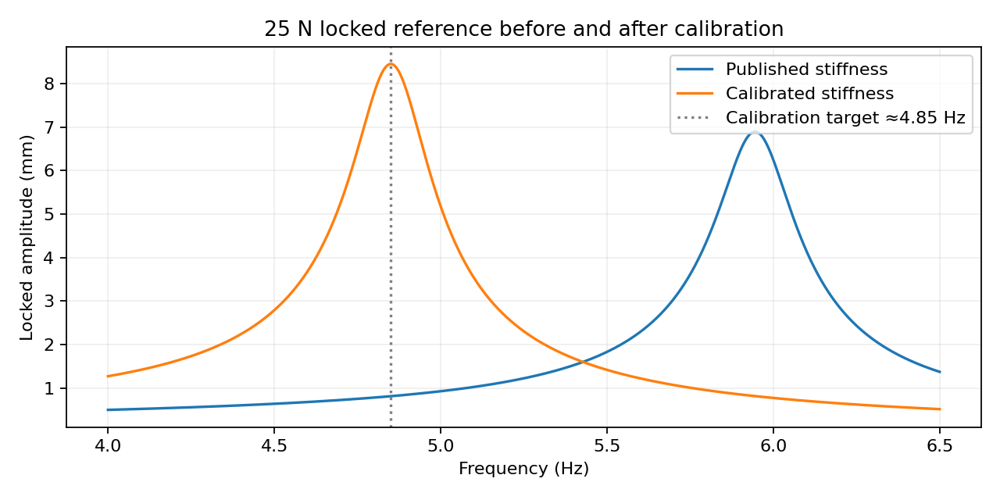
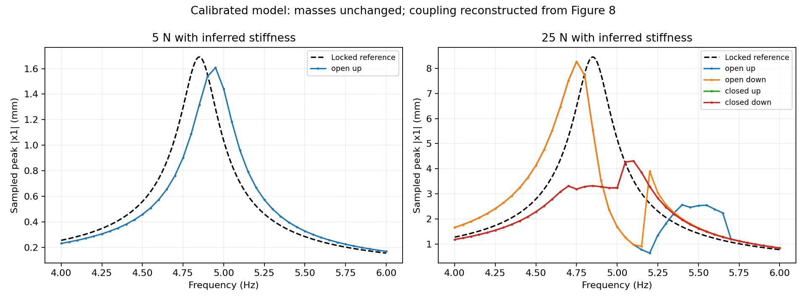
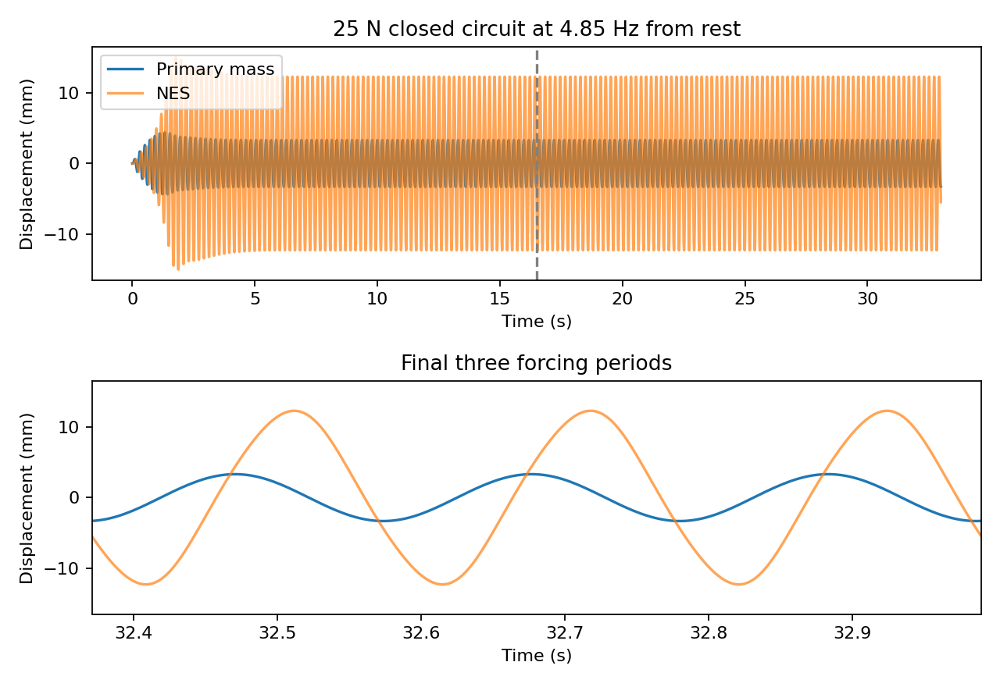

# Stiffness calibration study

The calibrated model is an inferred alternative, not a confirmed correction to the paper. The published model and its results remain unchanged.

## Derivation

For locked mass M=m1+m2=65.4 kg, the damped displacement resonance gives:

`k1 = M*(2*pi*f_peak)**2 + c1**2/(2*M)`

Taking the approximate plotted peak as 4.85 Hz gives **k1=60,804.406758 N/m**, compared with the reported 91,324 N/m. Both masses, damping, NES stiffness, resistance and reconstructed coupling remain unchanged. The calibrated locked peak is **8.4551 mm at 4.85 Hz** for 25 N. This is about 5.7% above the rounded 8 mm description in the paper.

A 4.80-4.90 Hz target sensitivity scenario gives k1=59,558.65-62,063.08 N/m; this is not a confidence interval. One resonance observation cannot independently identify mass and stiffness.

## Run

```bash
python -m pip install -r requirements.txt
python -m unittest discover -s tests -v
python calibrated.py --workers 4
```

Default study: five stepped continuation sweeps, 4-6 Hz in 0.05 Hz increments, 160 periods per point, 80 samples per period; last half analyzed. Both directions start independently from rest. There are 205 frequency points. Solver details and metric definitions are shared with reproduce.py.

## Results

| Run | Peak mm | Frequency Hz | Late-window flags | Fit-range flags |
|---|---:|---:|---:|---:|
| 5N_open_up | 1.6076 | 4.95 | 0 | 0 |
| 25N_open_up | 8.2730 | 4.75 | 0 | 0 |
| 25N_open_down | 8.2730 | 4.75 | 2 | 0 |
| 25N_closed_up | 4.3123 | 5.10 | 0 | 0 |
| 25N_closed_down | 4.3122 | 5.10 | 0 | 0 |

The maximum closed-circuit peak is 4.3123 mm versus the paper's approximately 3.8 mm analytical reference (+13.5%). These are different amplitude conventions: sampled time-domain peaks versus averaged fixed points. This is not a raw-data validation error. The calibration aligns the locked reference frequency but does not reproduce every nonlinear branch or experimental trajectory.







## Verification

All 11 unit tests pass. Six independent-from-rest checks cover 4.70, 4.85 and 5.10 Hz for open and closed circuits. Maximum relative changes in sampled peak are 0.03120% for finer output/tighter tolerance and 0.21301% for doubled duration.

The checks do not certify every sweep point, uniqueness of an attractor, or absence of long modulation. Two open-circuit downward-sweep points have late-window changes over 1%. All sampled trajectories remain inside the ±40 mm reconstructed coupling interval.

See [the original provenance report](REPLICATION.md) and [the machine-readable calibrated summary](results/calibrated/summary.json). Coefficients remain digitized estimates. No physical experiment or author confirmation is claimed.
