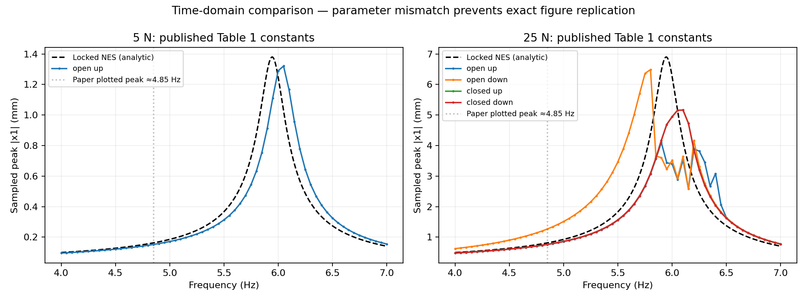
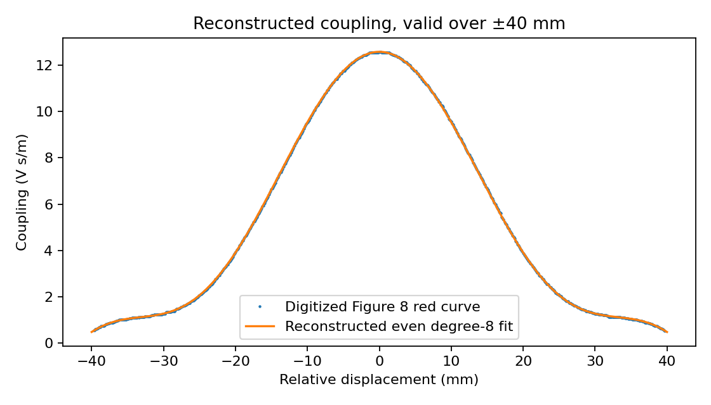
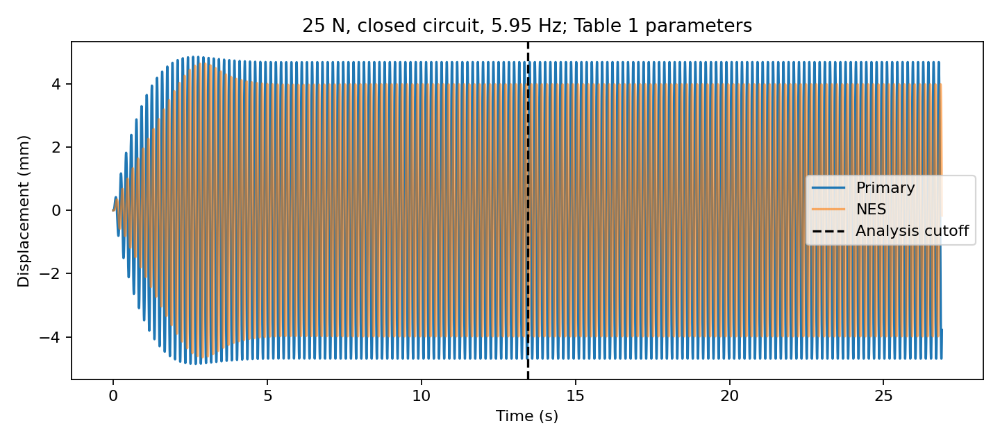

# Numerical findings

These are simulations using the reported table values and a digitized coupling fit. They are **not a validated reproduction of the published figures**.

Analytic locked-NES reference at 25 N: 6.8984 mm at 5.9450 Hz. The paper describes about 8 mm and plots the peak near 4.85 Hz.

## Sweeps

| Run | Maximum sampled primary peak (mm) | Frequency (Hz) | Points with late-window peak change >1% | Points outside coupling-fit range |
|---|---:|---:|---:|---:|
| 5N_open_up | 1.3206 | 6.05 | 0 | 0 |
| 25N_open_up | 4.1003 | 5.90 | 8 | 0 |
| 25N_open_down | 6.4853 | 5.80 | 5 | 0 |
| 25N_closed_up | 5.1612 | 6.10 | 0 | 0 |
| 25N_closed_down | 5.1610 | 6.10 | 0 | 0 |

The maxima are over the sampled frequency grid and observation windows, not optimized resonance peaks. Peak amplitude and forcing-frequency Fourier amplitude are both saved in the CSVs. The open-circuit curve depends on continuation direction.

## Selected convergence checks (independent runs from rest)

| Circuit | Frequency (Hz) | Peak (mm) | Resolution/tolerance change (%) | Doubled-duration change (%) |
|---|---:|---:|---:|---:|
| open | 4.85 | 0.7606 | 0.00000 | 0.00080 |
| open | 5.95 | 3.6133 | 0.00000 | 0.07551 |
| open | 6.20 | 4.1625 | 0.00000 | 0.00448 |
| closed | 4.85 | 0.7649 | 0.01759 | 0.00011 |
| closed | 5.95 | 4.6909 | 0.00000 | 0.00000 |
| closed | 6.20 | 3.8685 | 0.00000 | 0.00005 |

Maximum selected resolution/tolerance change: 0.01759%. Maximum selected doubled-duration change: 0.07551%.

These checks quantify sensitivity at six points; they do not certify every sweep point or establish a unique attractor. Larger changes can reflect long transients or modulation as well as numerical sensitivity.

## Figures

## Interpretation

The numerical workflow is operational, reproducible, and tested. The reported mass/stiffness mismatch must be resolved before claiming agreement with Figures 11, 16 or 17. No parameter was tuned to conceal that discrepancy. The reconstructed coupling coefficients also remain approximate rather than author supplied.

See [REPLICATION.md](../REPLICATION.md) for methods, units, provenance, polynomial validity limits, and remaining scientific questions.
